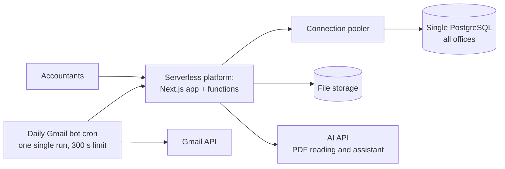
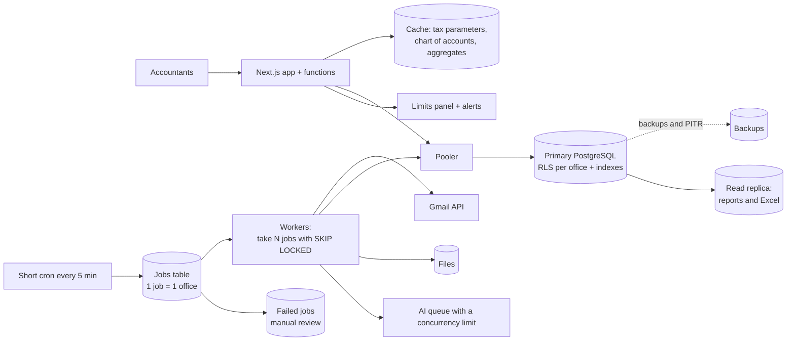

🇬🇧 English · 🇪🇸 [Español](DISENO.es.md)

# Redesigning Cont Finance to grow 100 times

A systems-design document about a real application in production: **Cont Finance**, a web platform for accountants and accounting offices in Costa Rica that turns electronic invoices into journal entries, VAT and financial statements. The exercise: **what breaks first if usage grows about 100 times, and what should change and when?**

Method: requirements → estimation → current architecture and single points of failure → proposal → phased plan with triggers. The numbers come from `estimates.py` (everything that is not measured is declared as an assumption) and from the documented limits of the current platform.

> **State of the data:** this is a design exercise. Everything below is an **architecture-based estimate, not a measurement** of the real system. The first phase of the plan is to measure.

*Terminology:* an "office" is an accounting office (the tenant of the platform); a "client" is a business whose books an office keeps.

## 1. Context

- Web application (Next.js, TypeScript), installable as a phone app. PostgreSQL database with **one multi-office schema**: all offices share tables and are separated by `office_id`.
- Scheduled jobs: (a) a **bot** that reads each client's Gmail and fetches invoices, (b) a **daily accounting process** that turns invoices into journal entries, (c) a daily snapshot of capacity limits.
- Files (invoice XML and PDF) in object storage. PDFs are read with AI models through an API.
- Billing is per **active client per month** (a client that received invoices or movements). The platform is at an early stage, with few offices.

## 2. Requirements

**Functional (what must never stop working)**
1. Receive invoices by email or manual upload without duplicating them (the 50-digit **numeric key** identifies each invoice).
2. Turn them into double-entry journal entries; entries are never deleted.
3. Compute VAT by rate and financial statements; export to Excel.
4. Fully isolate each office's data and, within an office, the clients each person can see.

**Non-functional (with proposed targets)**

| Attribute | Target |
|---|---|
| Application availability | 99.5 % monthly (≈ 3.6 h of tolerated downtime) |
| Latency of normal pages | p95 < 500 ms |
| Bot freshness | the previous day's invoices posted before 8:00 |
| Integrity | no duplicated or lost invoice; any retry is safe |
| Isolation | an office can never read another office's data |
| Recovery | restore the database to any point in the last 7 days |

**Out of scope:** multi-region, native apps, other countries, own e-invoicing.

## 3. Estimation

Assumptions (edit them in `estimates.py`; the three scenarios are assumptions too): 40 invoices per client per month, 150 KB of files and 5 KB in the database per invoice, 3 users per office, peak = 3 × average, 10 % of invoices without XML (they need AI).

| Quantity | Small scenario | Medium scenario | Design scenario (×100) |
|---|---|---|---|
| Active clients per month | 10 | 1,000 | 5,000 |
| Invoices per month | 400 | 40,000 | 200,000 |
| Invoices per day (30 days) | 13 | 1,333 | 6,667 |
| Total users | 3 | 60 | 300 |
| Requests/s at peak hour | 0.1 | 1.8 | 9.0 |
| DB connections in use at once (Little's law) | 0.0 | 0.4 | 1.8 |
| **Gmail cron in a single run (s)** | 7 (fits 300 s) | **667 (EXCEEDS)** | **3,333 (EXCEEDS)** |
| Gmail cron per office (s) | 7 (fits) | 33 (fits) | 33 (fits) |
| **Connected Gmail accounts (≈ 1 per client)** | 10 (below the cap of 100) | **1,000 (above the cap)** | **5,000 (above the cap)** |
| **Database growth (MB per month)** | 2 | 195 | **977 (exceeds 512 MB assumed)** |
| New files (GB per month) | 0.1 | 5.7 | 28.6 |
| Invoices needing AI (PDF only) per month | 40 | 4,000 | 20,000 |

**Reading the table** (this is the most important part of the document):

- **The web layer is not the problem.** Even in the ×100 scenario it is about 9 requests per second at the peak hour and fewer than 2 database connections in use at once. A pool of 5 connections per instance is plenty. Optimizing pages or adding web servers **would be effort in the wrong place**.
- **What breaks is background work and external limits**: (1) the Gmail bot's cron, which in a single run would need more than 50 minutes against a 5-minute limit; (2) the cap of 100 Gmail accounts while the app is not verified by Google; (3) database size.
- **The fix for the cron is cheap**: the work **per office** fits comfortably (33 s). The problem is grouping it all into one run; splitting it is enough.

## 4. Current architecture and single points of failure



| Single point of failure | What happens if it fails | Today |
|---|---|---|
| Bot cron in **one single run** | If it exceeds the time limit, clients at the end of the queue are skipped that day | Fits with 1 office |
| One single database | An outage or a full disk takes every office down | Depends on the plan |
| One single AI provider | Without it, PDF-only invoices stay "to review" | Acceptable: degradation, not an outage |
| Google's approval for Gmail | Above 100 unverified accounts, nobody new can connect Gmail | A business block, not a technical one |

## 5. Proposed architecture

The core idea: **do not change platform, split the work and protect the data**. Few new components, each with a clear trigger.



### 5.1 Gmail bot: from "one giant run" to "one job per office"

- A `jobs` table (`id`, `type`, `office_id`, `status`, `attempts`, `next_attempt`, `error`). A short cron (every 5 minutes) **enqueues** the day's pending jobs and another short cron **processes** a few.
- Each worker takes jobs with `SELECT … FOR UPDATE SKIP LOCKED`: several workers never take the same job, **without adding an external queue**. It is the simplest option that solves the problem; a managed queue (for example SQS or a platform queue) would be the next step if volume justifies it.
- **Idempotency**: a `UNIQUE (office_id, invoice_key)` constraint makes reprocessing an email harmless. Retries use exponential backoff; after N failures the job moves to the failed-jobs table and raises an alert.
- Expected result: each job's duration (≈ 33 s per office) is far below the limit, and a slow office no longer affects the others.

### 5.2 Database

- **Indexes**: `(office_id, date)` on invoices and entries, plus the unique-key ones. Review the 10 most frequent queries with `EXPLAIN` before growing.
- **Reinforced isolation**: PostgreSQL *Row Level Security* keyed on the session's `office_id`, as a second barrier on top of the application filter. Tested with a test that tries to read across offices.
- **Size**: it is the second limit to fall (≈ 1 GB a month in the ×100 scenario). Before reaching ~60 % of the plan, move up a plan or archive old closed invoices. **The database plan is an assumption in this document**: confirming its real limit is a Phase 0 task.
- **Read replica** for heavy reports (financial statements, Excel): it protects the day-to-day screens. Only when reports start competing with writes.
- **Partition by month** the invoice and entry tables **only when they pass tens of millions of rows**. At 200,000 invoices a month that is ~2.4 million a year: **not needed**. Recorded as a decision not taken.
- **Backups**: point-in-time recovery, and a test restore every quarter. A backup that was never restored does not count.

### 5.3 Cache

Only what changes rarely and is read often; never accounting figures without invalidation.

| What | Where | Lifetime | Invalidation |
|---|---|---|---|
| VAT rates and tax parameters | app memory | 24 h | on deploy |
| An office's chart of accounts | shared cache | 10 min | when the chart is edited (key with a per-office version) |
| The day's exchange rate | cache | until the next day | by date |
| Dashboard aggregates (income/expenses of the month) | cache | 60 s | when an invoice of that client is posted |

**Cache-aside** strategy. The hit rate is measured before widening it; if it is low, it is removed.

### 5.4 Artificial intelligence (PDF reading and assistant)

- **Queue with a concurrency limit** to the provider, to avoid hitting its per-minute limits.
- **Cache by file hash**: the same PDF is never paid for twice.
- **Graceful degradation**: if the provider fails, the invoice stays "to review" instead of blocking.
- **Spending cap** per office and per month, and an alert at 80 %. AI cost grows with PDF-only invoices (≈ 20,000 a month at ×100).

### 5.5 Security and compliance

- Verification of the application with **Google** (including a security assessment): it takes **about 8 weeks**, so it must start **before** approaching the cap of 100 accounts.
- Secrets outside the code, with rotation; Gmail tokens encrypted in the database.
- **Audit log** of sensitive actions (who closed a period, who changed permissions).
- Attempt limits (login, AI) already in the database; add per-IP limits at the edge when there is public traffic.

### 5.6 Observability

- Metrics: duration and result of each job, age of the oldest pending job, errors per office, p95 latency, database connections, database size, AI spend.
- Alerts: a job pending more than 6 hours; error rate > 2 %; database > 70 % of the plan; a cron that did not run for a day.
- A "limits" panel with bars and a 30-day projection would be the way to see all this at a glance.

## 6. Phased plan (each phase with its trigger)

| Phase | What is done | Trigger to do it | Cost |
|---|---|---|---|
| **0. Measure** | Controlled load test with test data; confirm the plan and limit of the database; measure the real time per Gmail connection | **Now** | Time |
| **1. Jobs per office** | Jobs table, `SKIP LOCKED`, retries, failed jobs | More than ~10 offices, or any cron run > 150 s | Time; no new infrastructure |
| **2. Google verification** | Start the verification process and security assessment | At 60 connected Gmail accounts (≈ 8 weeks ahead) | **MONEY**: the security assessment may have a cost, to be confirmed |
| **3. Database** | Reviewed indexes, RLS, bigger plan, a restored test backup | Database at 60 % of the plan, or any query p95 > 500 ms | **MONEY**: paid plan, to be confirmed |
| **4. Cache** | Only what in table 5.3 shows a measured benefit | Latency or database load measured as a problem | Low |
| **5. Replica and partitions** | Read replica; monthly partitions | Slow reports / tables over tens of millions of rows | **MONEY** |

**Decisions NOT taken now (and why)**
- *Microservices, Kubernetes, multi-region:* at 9 requests per second in the ×100 scenario they would add cost and operations without solving any real bottleneck.
- *Partitioning and replicas:* costly to operate, and the data does not justify them yet.
- *Rewriting the bot:* splitting it per office is enough.

## 7. Risks and open questions

- **The estimates are not measured.** The assumptions that weigh most: 40 invoices per client per month, ~10 s per Gmail connection, and 5 KB per invoice in the database. A 3× error in any of them changes the dates of each phase.
- **What are the database plan and its storage limit?** Without that, the 512 MB is an assumption.
- **Dependence on Google**: verification can be slow or rejected; without it, growth through Gmail stops at 100 accounts.
- **Multi-office in a single database**: a filtering mistake would expose another office's data. That is why RLS and isolation tests come before any performance optimization.

## 8. How to reproduce the numbers

```bash
python3 estimates.py
```

It prints the table in section 3. Change `ASSUMPTIONS` or `SCENARIOS` and run it again.

## 9. Experiments with the assumptions

Run with `python3 experiments.py`. Which conclusions change when one assumption moves (×100 design scenario unless noted):

| Assumption | Gmail cron, single run | Gmail cron, per office | Database growth | New files |
|---|---|---|---|---|
| Baseline: 40 invoices per client, 10 s per connection | 3,333 s (exceeds) | 33 s (fits) | 977 MB/month (exceeds 512 MB) | 28.6 GB/month |
| 120 invoices per client | 3,333 s (exceeds) | 33 s (fits) | **2,930 MB/month** (exceeds) | 85.8 GB/month |
| 10 invoices per client | 3,333 s (exceeds) | 33 s (fits) | **244 MB/month (no longer exceeds)** | 7.2 GB/month |
| 60 s per Gmail connection | **20,000 s** (exceeds) | **200 s (fits, but with little margin)** | 977 MB/month | 28.6 GB/month |

**What I learned:**

- **The main conclusion is robust**: under every assumption, the cron in a single run exceeds the 300 s limit, and splitting it per office solves it. That decision does not depend on the exact numbers.
- **Database size does depend on the assumptions**: the "second problem" goes from nonexistent (10 invoices per client) to severe (120). That is why Phase 0 is to measure the real invoice volume per client.
- **The model is simple in one important point**: here the bot's time depends on the number of Gmail connections, not on the number of invoices on each. In reality a client with many invoices takes longer. It is a simplification that should be measured.
- If each connection takes 60 s, the per-office work (200 s) still fits, but with a margin of only 100 s: in that case large offices should also be split into several jobs.
