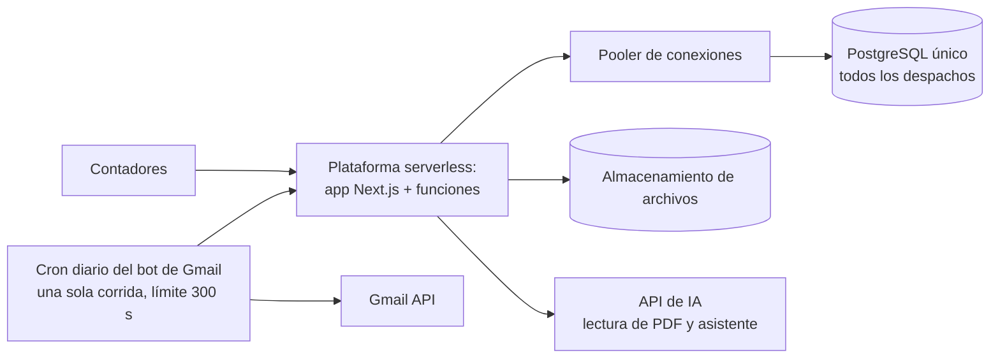
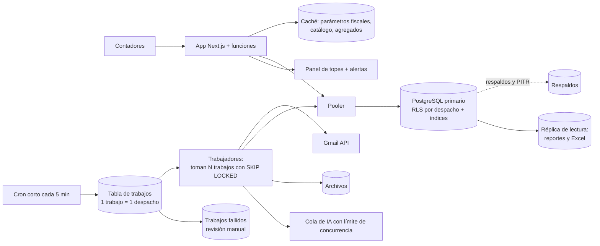

🇬🇧 [English](DESIGN.md) · 🇪🇸 Español

# Rediseño de Cont Finance para crecer 100 veces

Documento de diseño de sistemas sobre una aplicación real en producción: **Cont Finance**, plataforma web para contadores y despachos contables de Costa Rica que convierte facturas electrónicas en asientos contables, IVA y estados financieros. El ejercicio: **¿qué se rompe primero si el uso crece unas 100 veces, y qué conviene cambiar y cuándo?**

Método: requisitos → estimación → arquitectura actual y puntos únicos de falla → propuesta → plan por fases con disparadores. Las cifras salen de `estimates.py` (todo lo no medido está declarado como supuesto) y de los límites documentados de la plataforma actual.

> **Estado de los datos:** es un ejercicio de diseño. Todo lo que sigue son **estimaciones por arquitectura, no mediciones** del sistema real. La primera fase del plan es medir.

## 1. Contexto

- Aplicación web (Next.js, TypeScript) instalable como app en el celular. Base de datos PostgreSQL con **un esquema multi-despacho**: todos los despachos comparten tablas y se separan por `despacho_id`.
- Tareas programadas: (a) un **bot** que lee los correos de Gmail de cada cliente y trae las facturas, (b) un **proceso diario de contabilidad** que convierte facturas en asientos, (c) una foto diaria de «topes» de capacidad.
- Archivos (XML y PDF de las facturas) en almacenamiento de objetos. Lectura de PDFs con modelos de IA por API.
- Cobro por **cliente activo del mes** (el que recibió facturas o movimientos). La plataforma está en una etapa temprana, con pocos despachos.

## 2. Requisitos

**Funcionales (lo que no puede dejar de hacer)**
1. Recibir facturas por correo o carga manual, sin duplicarlas (la **clave numérica de 50 dígitos** identifica cada factura).
2. Convertirlas en asientos con partida doble; los asientos no se borran.
3. Calcular IVA por tarifa y estados financieros; exportar a Excel.
4. Aislar por completo los datos de cada despacho y, dentro de uno, los clientes que ve cada persona.

**No funcionales (con metas propuestas)**

| Atributo | Meta |
|---|---|
| Disponibilidad de la aplicación | 99,5 % mensual (≈ 3,6 h de caída tolerada) |
| Latencia de páginas normales | p95 < 500 ms |
| Frescura del bot | las facturas del día anterior contabilizadas antes de las 8:00 |
| Integridad | ninguna factura duplicada ni perdida; cualquier reintento es seguro |
| Aislamiento | un despacho nunca puede leer datos de otro |
| Recuperación | restaurar la base a cualquier punto de los últimos 7 días |

**Fuera de alcance**: multi-región, aplicaciones nativas, otros países, facturación electrónica propia.

## 3. Estimación

Supuestos (editar en `estimates.py`; los tres escenarios también son supuestos): 40 facturas por cliente al mes, 150 KB de archivos y 5 KB en base por factura, 3 usuarios por despacho, pico = 3 × promedio, 10 % de facturas sin XML (necesitan IA).

| Magnitud | Escenario pequeño | Escenario medio | Escenario de diseño (×100) |
|---|---|---|---|
| Clientes activos al mes | 10 | 1 000 | 5 000 |
| Facturas al mes | 400 | 40 000 | 200 000 |
| Facturas al día (30 días) | 13 | 1 333 | 6 667 |
| Usuarios totales | 3 | 60 | 300 |
| Peticiones/s en hora pico | 0,1 | 1,8 | 9,0 |
| Conexiones a la base en uso a la vez (ley de Little: peticiones/s × latencia) | 0,0 | 0,4 | 1,8 |
| **Cron de Gmail en una sola corrida (s)** | 7 (cabe en 300 s) | 667 (EXCEDE en 300 s) | 3 333 (EXCEDE en 300 s) |
| Cron de Gmail por despacho (s) | 7 (cabe) | 33 (cabe) | 33 (cabe) |
| **Cuentas de Gmail conectadas (≈ 1 por cliente)** | 10 (bajo el tope de 100) | 1 000 (sobre el tope de 100) | 5 000 (sobre el tope de 100) |
| **Crecimiento de la base de datos (MB al mes)** | 2 (bajo 512 MB supuestos) | 195 (bajo 512 MB supuestos) | 977 (supera 512 MB supuestos) |
| Archivos nuevos (GB al mes) | 0,1 | 5,7 | 28,6 |
| Facturas que necesitan IA (solo PDF) al mes | 40 | 4 000 | 20 000 |

**Lectura del cuadro** (esto es lo más importante del documento):

- **La capa web no es el problema.** Incluso en el escenario ×100 son unas 9 peticiones por segundo en la hora pico y menos de 2 conexiones a la base en uso a la vez. Con un pool de 5 conexiones por instancia sobra. Optimizar páginas o añadir servidores web **sería esfuerzo mal puesto**.
- **Lo que se rompe es el trabajo en segundo plano y los límites externos**: (1) el cron del bot de Gmail, que en una sola corrida necesitaría más de 50 minutos contra un límite de 5; (2) el tope de 100 cuentas de Gmail mientras la app no esté verificada por Google; (3) el tamaño de la base de datos.
- **El arreglo del cron es barato**: el trabajo **por despacho** cabe holgado (33 s). El problema es agruparlo todo en una corrida; basta repartirlo.

## 4. Arquitectura actual y puntos únicos de falla



| Punto único de falla | Qué pasa si falla | Hoy |
|---|---|---|
| Cron del bot en **una sola corrida** | Si pasa el límite de tiempo, los clientes del final de la fila quedan sin revisar ese día | Cabe con 1 despacho |
| Una sola base de datos | Caída o llenado = todos los despachos caen | Depende del plan contratado |
| Un solo proveedor de IA | Sin él, las facturas solo-PDF quedan «por revisar» | Aceptable: es degradación, no caída |
| Aprobación de Google para Gmail | Con más de 100 cuentas sin verificación, nadie nuevo puede conectar Gmail | Bloqueo de negocio, no técnico |

## 5. Arquitectura propuesta

La idea central: **no cambiar de plataforma, sino repartir el trabajo y proteger los datos**. Pocos componentes nuevos, cada uno con un disparador claro.



### 5.1 Bot de Gmail: de «una corrida gigante» a «un trabajo por despacho»

- Una tabla `trabajos` (`id`, `tipo`, `despacho_id`, `estado`, `intentos`, `proximo_intento`, `error`). Un cron corto (cada 5 minutos) **encola** los trabajos pendientes del día y otro cron corto **procesa** unos pocos.
- Cada trabajador toma trabajos con `SELECT … FOR UPDATE SKIP LOCKED`: así varios trabajadores nunca toman el mismo trabajo, **sin añadir una cola externa**. Es la opción más simple que resuelve el problema; una cola administrada (por ejemplo SQS o una cola de la plataforma) sería el paso siguiente si el volumen la justifica.
- **Idempotencia**: una restricción `UNIQUE (despacho_id, clave_factura)` hace que reprocesar un correo sea inofensivo. Los reintentos usan espera exponencial; tras N fallos el trabajo pasa a la tabla de fallidos y avisa.
- Resultado esperado: el tiempo de cada trabajo (≈ 33 s por despacho) está muy por debajo del límite, y un despacho lento ya no afecta a los demás.

### 5.2 Base de datos

- **Índices**: `(despacho_id, fecha)` en facturas y asientos, y los de clave única. Revisar con `EXPLAIN` las 10 consultas más frecuentes antes de crecer.
- **Aislamiento reforzado**: *Row Level Security* de PostgreSQL con `despacho_id` de la sesión, como segunda barrera además del filtro en la aplicación. Se prueba con un test que intenta leer entre despachos.
- **Tamaño**: es el segundo límite en caer (≈ 1 GB al mes en el escenario ×100). Antes de llegar a ~60 % del plan, subir de plan o archivar facturas antiguas ya cerradas. **El plan de la base es un supuesto en este documento**: confirmar su límite real es una tarea de la Fase 0.
- **Réplica de lectura** para reportes pesados (estados financieros, Excel): protege las pantallas del día a día. Solo cuando los reportes empiecen a competir con las escrituras.
- **Particionar por mes** las tablas de facturas y asientos **solo cuando superen decenas de millones de filas**. A 200 000 facturas al mes son ~2,4 millones al año: **no hace falta**. Se deja anotado como decisión no tomada.
- **Respaldos**: recuperación a un punto en el tiempo, y una restauración de prueba cada trimestre. Un respaldo que nunca se restauró no cuenta.

### 5.3 Caché

Solo lo que cambia poco y se lee mucho; nunca cifras contables sin invalidación.

| Qué | Dónde | Vida | Invalidación |
|---|---|---|---|
| Tarifas de IVA y parámetros fiscales | memoria de la app | 24 h | al desplegar |
| Catálogo de cuentas de un despacho | caché compartida | 10 min | al editar el catálogo (clave con versión por despacho) |
| Tipo de cambio del día | caché | hasta el día siguiente | por fecha |
| Agregados del panel (ingresos/gastos del mes) | caché | 60 s | al contabilizar una factura del cliente |

Estrategia **cache-aside**. Se mide la tasa de aciertos antes de ampliarla; si es baja, se quita.

### 5.4 Inteligencia artificial (lectura de PDFs y asistente)

- **Cola con límite de concurrencia** hacia el proveedor para no chocar con sus límites por minuto.
- **Caché por hash del archivo**: el mismo PDF nunca se paga dos veces.
- **Degradación elegante**: si el proveedor falla, la factura queda «por revisar» en vez de bloquearse.
- **Tope de gasto** por despacho y por mes, y alerta al llegar al 80 %. El gasto en IA crece con las facturas solo-PDF (≈ 20 000 al mes en ×100).

### 5.5 Seguridad y cumplimiento

- Verificación de la aplicación ante **Google** (evaluación de seguridad incluida): requiere **unas 8 semanas**, así que debe iniciarse **antes** de acercarse al tope de 100 cuentas.
- Secretos fuera del código, con rotación; tokens de Gmail cifrados en la base.
- **Registro de auditoría** de acciones sensibles (quién cerró un período, quién cambió permisos).
- Límite de intentos (login, IA) ya en la base de datos; añadir límites por IP en el borde cuando haya tráfico público.

### 5.6 Observabilidad

- Métricas: duración y resultado de cada trabajo, antigüedad del trabajo pendiente más viejo, errores por despacho, latencia p95, conexiones a la base, tamaño de la base, gasto en IA.
- Alertas: trabajo pendiente más de 6 horas; tasa de errores > 2 %; base > 70 % del plan; cron sin ejecutarse un día.
- Un panel de «topes» con barras y proyección a 30 días sería la forma de ver todo esto de un vistazo.

## 6. Plan por fases (cada una con su disparador)

| Fase | Qué se hace | Disparador para hacerla | Costo |
|---|---|---|---|
| **0. Medir** | Prueba de carga controlada con datos de prueba; confirmar el plan y el límite de la base; medir el tiempo real por conexión de Gmail | **Ahora** | Tiempo |
| **1. Trabajos por despacho** | Tabla de trabajos, `SKIP LOCKED`, reintentos, trabajos fallidos | Más de ~10 despachos o cualquier corrida del cron > 150 s | Tiempo; sin infraestructura nueva |
| **2. Verificación de Google** | Iniciar el proceso de verificación y la evaluación de seguridad | Con 60 cuentas de Gmail conectadas (≈ 8 semanas de anticipación) | **DINERO**: la evaluación de seguridad puede tener costo, por confirmar |
| **3. Base de datos** | Índices revisados, RLS, plan mayor, respaldo restaurado de prueba | Base al 60 % del plan o cualquier consulta p95 > 500 ms | **DINERO**: plan de pago, por confirmar |
| **4. Caché** | Solo lo de la tabla 5.3 que mida un beneficio | Latencia o carga de la base medidas como problema | Bajo |
| **5. Réplica y particiones** | Réplica de lectura; particiones por mes | Reportes lentos / tablas > decenas de millones de filas | **DINERO** |

**Decisiones que NO se toman ahora (y por qué)**
- *Microservicios, Kubernetes, multi-región:* a 9 peticiones por segundo en el escenario ×100, agregarían costo y operación sin resolver ningún cuello de botella real.
- *Particionado y réplicas:* son costosos de operar y los datos no los justifican todavía.
- *Reescribir el bot:* basta con repartirlo por despacho.

## 7. Riesgos y preguntas abiertas

- **Las estimaciones no están medidas.** Los supuestos de más peso son: 40 facturas por cliente al mes, ~10 s por conexión de Gmail y 5 KB por factura en la base. Un error de 3 veces en cualquiera cambia las fechas de cada fase.
- **¿Cuál es el plan y el límite de almacenamiento de la base?** Sin esto, los 512 MB son un supuesto.
- **Dependencia de Google**: la verificación puede tardar o ser rechazada; sin ella el crecimiento por Gmail se detiene en 100 cuentas.
- **Multi-despacho en una sola base**: un error de filtrado expondría datos ajenos. Por eso RLS y las pruebas de aislamiento van antes que cualquier optimización de rendimiento.

## 8. Cómo reproducir las cifras

```bash
python3 estimates.py
```

Imprime la tabla de la sección 3. Cambiar `SUPUESTOS` o `ESCENARIOS` y volver a correr.

## 9. Experimentos con los supuestos

Se corren con `python3 experiments.py`. Qué conclusiones cambian al mover un supuesto (escenario de diseño ×100 salvo indicación):

| Supuesto | Cron de Gmail, una sola corrida | Cron de Gmail, por despacho | Crecimiento de la base | Archivos nuevos |
|---|---|---|---|---|
| Base: 40 facturas por cliente, 10 s por conexión | 3 333 s (excede) | 33 s (cabe) | 977 MB/mes (supera 512 MB) | 28,6 GB/mes |
| 120 facturas por cliente | 3 333 s (excede) | 33 s (cabe) | **2 930 MB/mes** (supera) | 85,8 GB/mes |
| 10 facturas por cliente | 3 333 s (excede) | 33 s (cabe) | **244 MB/mes (ya no supera)** | 7,2 GB/mes |
| 60 s por conexión de Gmail | **20 000 s** (excede) | **200 s (cabe, pero con poco margen)** | 977 MB/mes | 28,6 GB/mes |

**Qué aprendí:**

- **La conclusión principal es robusta**: con cualquiera de los supuestos, el cron en una sola corrida excede el límite de 300 s y repartirlo por despacho lo resuelve. Esa decisión no depende de los números exactos.
- **El tamaño de la base sí depende de los supuestos**: el «segundo problema» pasa de inexistente (10 facturas por cliente) a muy grave (120). Por eso la Fase 0 es medir el volumen real de facturas por cliente.
- **El modelo es simple en un punto importante**: el tiempo del bot depende aquí del número de conexiones de Gmail, no del número de facturas de cada una. En la realidad, un cliente con muchas facturas tarda más. Es una simplificación que habría que medir.
- Si cada conexión tarda 60 s, el trabajo por despacho (200 s) aún cabe, pero con un margen de apenas 100 s: en ese caso convendría partir también los despachos grandes en varios trabajos.
